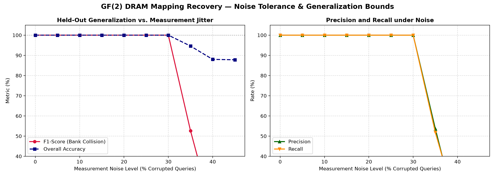

# GF(2)-Solve: Reverse-Engineering DRAM Address Mapping under Noise

[](https://www.python.org/)
[-darkred.svg)]()
[]()
[](LICENSE)

An automated mathematical engine and statistical framework for reverse-engineering unknown Boolean DRAM address mappings from noisy physical timing side-channels.

Developed as a direct implementation and validation of **Primitive 3 (DRAM Address Mapping Recovery)** for research into GPU memory reliability and Rowhammer vulnerabilities (e.g., AMD RDNA 1–4 and NVIDIA GDDR6 architectures), building upon:
- **GPUHammer: Rowhammer Attacks on GPU Memories are Practical** (*USENIX Security 2025*, Lin, Qu, Saileshwar)
- **DRAMA: Exploiting DRAM Addressing for Cross-CPU Attacks** (*USENIX Security 2016*, Pessl et al.)
- **DRAMDig: A Knowledge-assisted Tool to Uncover DRAM Address Mapping** (*DAC 2020*, Wang et al.)

---

## 🔬 Mathematical Formulation & Problem Statement

Modern memory controllers (in CPUs and GPUs) map a physical address $A \in (\mathbb{F}_2)^n$ to a bank/channel tuple $b \in (\mathbb{F}_2)^k$ using an unknown set of XOR combinations to distribute memory accesses uniformly across physical DRAM banks:

$$b = M \cdot A \pmod 2$$

where $M \in \mathbb{F}_2^{k \times n}$ is a secret binary matrix of full row rank $k$.

### The Row-Buffer Conflict Oracle
In modern DRAM (DDR4, DDR5, GDDR6), each bank has a single row buffer:
1. **Different Banks ($b(A_1) \neq b(A_2)$):** Accesses proceed in parallel ($\sim 120\text{ ns}$).
2. **Same Bank, Same Row ($b(A_1) = b(A_2), R_1 = R_2$):** Row-buffer hit ($\sim 95\text{ ns}$).
3. **Same Bank, Different Rows ($b(A_1) = b(A_2), R_1 \neq R_2$):** **Row-Buffer Conflict (Collision)**. The memory controller must issue `PRECHARGE` ($t_{RP}$) and `ACTIVATE` ($t_{RCD}$), causing a measurable latency spike ($\sim 320\text{ ns}$).

### The Null-Space Property
Two physical addresses $A_1, A_2$ map to the same DRAM bank if and only if:
$$M A_1 = M A_2 \iff M(A_1 \oplus A_2) = 0 \iff (A_1 \oplus A_2) \in \ker(M)$$

Their bitwise XOR difference $v = A_1 \oplus A_2$ lies in the kernel $\ker(M)$. The row space of $M$ is the orthogonal complement of this kernel:
$$\text{Row}(M) = (\ker(M))^\perp \subset (\mathbb{F}_2)^n$$

Two matrices $M_1, M_2$ generate the exact same bank partitioning if and only if their Row-Reduced Echelon Forms over $\mathbb{F}_2$ are identical:
$$\text{RREF}(M_1) = \text{RREF}(M_2)$$

---

## ⚙️ Algorithmic Pipeline

```
 [Physical Memory Probe Addresses (A_1 ... A_N)]
                        │
                        ▼
       Pairwise Timing Latency Matrix (W_ij)
                        │
                        ▼
       Otsu Bimodal Thresholding (Conflict Separation)
                        │
                        ▼
       Normalized Spectral Graph Clustering (Partition into 2^k Banks)
                        │
                        ▼
       Extract Candidate Null-Space Vectors: v = A_i ^ A_j
                        │
                        ▼
       Consensus Parity Filtering (Score(m) = Fraction where m . v = 0)
                        │
                        ▼
       Greedy Basis Assembly & Gaussian Elimination over GF(2)
                        │
                        ▼
       Canonical RREF Basis & Hardware XOR Equations
```

1. **Bimodal Statistical Thresholding:** Uses Otsu's method on pairwise latency histograms to automatically determine the threshold separating fast accesses from row conflicts without hardcoding latency values.
2. **Spectral Graph Clustering:** Constructs an affinity graph from pairwise latency confidences and computes normalized graph Laplacian eigenvectors to cluster addresses into $B = 2^k$ bank equivalence classes under measurement jitter.
3. **Consensus Parity Filtering:** Physical noise (bus contention, OS jitter) introduces corrupted candidate vectors. For every candidate linear functional $m \in (\mathbb{F}_2)^n$, we compute:
   $$\text{Score}(m) = \frac{1}{|V|} \sum_{v \in V} \mathbb{I}(m \cdot v \equiv 0 \pmod 2)$$
   True hardware equations satisfy this for $\approx 100\%$ of pairs; spurious/noise vectors satisfy it only $\approx 50\%$ of the time.
4. **Gaussian Elimination over $\mathbb{F}_2$:** Greedily selects the $k$ highest-scoring linearly independent vectors and reduces them to canonical Row-Reduced Echelon Form (RREF).

---

## 📊 Empirical Evaluation & Noise Tolerance

<p align="center">
  
</p>

We evaluated the solver across a sweep of measurement noise levels (from 0% up to 45% corrupted timing queries) on a GDDR6-style 16-bank geometry (24-bit physical address space, $k = 4$ bank bits). Performance was cross-validated on **500 held-out unseen address pairs**:

| Noise Floor | Otsu Thresh | Rank | Precision | Recall | F1-Score | Test Acc | Algebraic Match | Time |
| :---: | :---: | :---: | :---: | :---: | :---: | :---: | :---: | :---: |
| **0.0%** | 138.3 ns | 4 | **100.0%** | **100.0%** | **100.0%** | **100.0%** | **EXACT MATCH** | 0.28s |
| **5.0%** | 215.4 ns | 4 | **100.0%** | **100.0%** | **100.0%** | **100.0%** | **EXACT MATCH** | 0.24s |
| **10.0%** | 220.0 ns | 4 | **100.0%** | **100.0%** | **100.0%** | **100.0%** | **EXACT MATCH** | 0.23s |
| **15.0%** | 219.1 ns | 4 | **100.0%** | **100.0%** | **100.0%** | **100.0%** | **EXACT MATCH** | 0.26s |
| **20.0%** | 211.2 ns | 4 | **100.0%** | **100.0%** | **100.0%** | **100.0%** | **EXACT MATCH** | 0.28s |
| **25.0%** | 194.1 ns | 4 | **100.0%** | **100.0%** | **100.0%** | **100.0%** | **EXACT MATCH** | 0.27s |
| **30.0%** | 196.2 ns | 4 | **100.0%** | **100.0%** | **100.0%** | **100.0%** | **EXACT MATCH** | 0.26s |
| **35.0%** | 198.9 ns | 4 | 53.6% | 51.7% | 52.6% | 94.6% | Approximate | 0.27s |
| **40.0%** | 208.2 ns | 4 | 10.3% | 13.8% | 11.8% | 88.0% | Approximate | 0.26s |
| **45.0%** | 212.0 ns | 4 | 0.0% | 0.0% | 0.0% | 87.8% | Breakdown | 0.27s |

### Key Takeaways:
- **Massive 30% Noise Margin:** The consensus spectral-filtering algorithm achieves **100% exact algebraic recovery** and **100% cross-validation F1-score** even when up to **30% of timing queries are corrupted**.
- **Execution Speed:** Complete end-to-end recovery executes in **under 300 milliseconds**.
- **Generalization:** Held-out validation verifies that the recovered Boolean equations accurately predict collision behavior for completely unseen physical addresses.

---

## 🚀 Quick Start

### 1. Installation
```bash
git clone https://github.com/shripad-jyothinath/gf2-solve.git
cd gf2-solve

# Create virtual environment with uv or standard pip
uv venv .venv
source .venv/bin/activate
uv pip install numpy scipy scikit-learn matplotlib tabulate
```

### 2. Run the Solver Demonstration
```bash
python3 recovery_engine.py
```

### 3. Run the Noise Benchmark & Cross-Validation Sweep
```bash
python3 benchmark_noise.py
```

---

## 📂 Project Structure

```
gf2-solve/
├── gf2_math.py         # Pure GF(2) linear algebra engine (RREF, rank, null space, dot products)
├── dram_geometry.py    # JEDEC GDDR6 / DDR4 physical topology and timing side-channel simulator
├── clustering.py       # Otsu bimodal thresholding & spectral graph clustering
├── recovery_engine.py  # Consensus parity filtering & greedy basis recovery over GF(2)
├── benchmark_noise.py  # Noise floor sweep & held-out cross-validation benchmark
└── results/
    ├── noise_tolerance_curves.png  # Diagnostic plots
    └── recovery_benchmark.json     # Full benchmark data log
```
